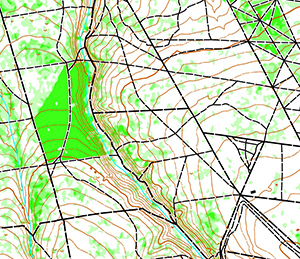

# Lidar'O

*[English version](README.md)*

**Lidar'O génère automatiquement une base de carte pour la course d'orientation** à partir des données LiDAR et des référentiels géographiques. Il produit un fichier `.omap` prêt à ouvrir dans OpenOrienteering Mapper, avec le relief, le réseau routier, l'hydrographie et une première proposition de végétation.

Le cartographe conserve la vérification terrain, la correction de la végétation et l'ajout des détails fins.

---

<!-- CAPTURE D'ÉCRAN — EN ATTENTE
     Lancer : python main.py gui
     Capturer la fenêtre Lidar'O avec un terrain chargé et les cases LiDAR / BD TOPO renseignées.
     Enregistrer sous : docs/images/capture_gui.png
     Retirer tout chemin personnel visible avant l'enregistrement. -->


*Résultat Lidar'O ouvert dans OpenOrienteering Mapper — terrain Grimbosq (Normandie)*

---

## Ce que Lidar'O produit

```
vectorisé et symbolisé :
  relief            — courbes de niveau depuis Karttapullautin
  chemins / routes  — BD TOPO
  bâtiments         — BD TOPO
  hydrographie      — BD TOPO
  terrain découvert et zones agricoles
  zones interdites
  végétation 406 / 408 / 410  — estimation automatique (voir modes ci-dessous)

assemblage et géoréférencement
→ fichier .omap ouvrable directement dans OpenOrienteering Mapper
```

## Ce que Lidar'O ne produit pas

- Falaises ni rochers (symboles 201/202 désactivés)
- Symboles ponctuels ni plantations en rangs
- Carte terminée : la végétation automatique est une base de travail à corriger au terrain

---

## Modes de végétation

| Mode | Principe | Statut |
|---|---|---|
| `kp` (par défaut) | Karttapullautin extrait une image de végétation depuis le LiDAR ; les couches 406/408/410 sont vectorisées à partir de cette image. | Stable |
| `supervised_e` | Calcul direct depuis la structure verticale du nuage de points — 4 niveaux (401/406/408/410). Performances variables selon le type de forêt. | Expérimental |

Les deux modes fonctionnent de manière autonome depuis les données LiDAR, sans référentiel cartographique extérieur à l'inférence.

> **Mode supervised_e** — nécessite un fichier modèle pré-entraîné de 786 Mo (`experiments/loto_v1/final_model/model_e_final.pkl`), non distribué dans le dépôt.
> Sans ce fichier, le mode `kp` fonctionne normalement.
> Voir [docs/supervised_e.md](docs/supervised_e.md) pour l'installation, la configuration et les résultats.

---

## Installation

**Aucun installateur disponible** — installation depuis les sources uniquement.

### Prérequis

- **Windows** : [Miniconda](https://docs.conda.io/en/latest/miniconda.html) recommandé pour les dépendances géospatiales
- **Linux / Docker** : image fournie (`Dockerfile`)
- **OpenOrienteering Mapper** : [openorienteering.org](https://www.openorienteering.org/) pour ouvrir le `.omap` produit

### Étapes rapides (Windows)

```bat
rem 1. Cloner le dépôt
git clone https://github.com/guiguoz/lidar-o.git
cd lidar-o

rem 2. Installer les dépendances (Miniconda Prompt)
conda install -c conda-forge python=3.11 geopandas shapely scipy numpy ^
    python-pdal pdal rasterio ezdxf requests pyyaml
```

Vérifier :

```bat
python main.py --version
```

> Pour les étapes détaillées (environnement virtuel, dépannage, Docker) →
> [docs/guide_utilisateur.md § C — Installer](docs/guide_utilisateur.md#c--installer)

---

## Premier projet

### 1. Télécharger les données

| Donnée | Source | Emplacement |
|---|---|---|
| Dalles LiDAR HD (`*.copc.laz`) | [IGN Géoplateforme](https://geoservices.ign.fr/lidarhd) | `LIDAR/` ou `--tiles-dir DIR` |
| BD TOPO (GPKG département, France) | [geoservices.ign.fr/bdtopo](https://geoservices.ign.fr/bdtopo) | `data/bdtopo/` |

Une dalle 1 km² suffit pour un premier test.

### 2. Initialiser le terrain

```bash
# Depuis des coordonnées géographiques (CRS déduit automatiquement)
python main.py init ma_foret --center 49.043 -0.421

# Ou avec une emprise projetée explicite
python main.py init ma_foret --bbox 448000 6886000 451000 6889000 --crs EPSG:2154
```

### 3. Vérifier et configurer

```bash
python main.py setup ma_foret   # dialogue interactif : LiDAR, BD TOPO, KP
python main.py check ma_foret   # contrôle complet avant traitement
```

### 4. Lancer le pipeline

```bash
python main.py run ma_foret --tiles-dir LIDAR/
```

Durée typique : 45–60 min pour 6 dalles (2×3 km), dominé par Karttapullautin.

### 5. Ouvrir le résultat

Fichier produit : `output/ma_foret.omap` — ouvrir dans OpenOrienteering Mapper.

---

## Interface graphique

```bash
python main.py gui
```

Ouvre une fenêtre avec sélecteurs LiDAR / BD TOPO, grille de couverture des dalles et bouton **Générer**. Nécessite que le terrain soit déjà déclaré dans `config.yaml` (via `init` ou édition manuelle).

---

## Domaine de validité

| | |
|---|---|
| **Testé** | Forêt normande de feuillus (Normandie) — LiDAR HD IGN — COPC — Lambert-93 — acquisition hors feuillaison |
| **Non testé** | Forêts de montagne, landes, résineux denses, acquisitions en feuillaison |
| **Portable** | CRS déduit automatiquement ; convergence des méridiens calculée ; deux pays traités (France, Estonie) |
| **Attention** | La portabilité du code ne garantit pas la qualité des résultats végétation hors du domaine testé |

La végétation automatique est une **estimation** — elle doit être vérifiée et complétée par relevé terrain avant diffusion d'une carte officielle.

---

## Guide complet

→ **[docs/guide_utilisateur.md](docs/guide_utilisateur.md)** — installation pas à pas, configuration, exemple complet, dépannage

Documentation technique :
- [docs/supervised_e.md](docs/supervised_e.md) — mode supervised_e : architecture, modèle, résultats LOTO
- [docs/portabilite.md](docs/portabilite.md) — utilisation hors France
- [docs/bilan_v0.md](docs/bilan_v0.md) — expérimentations et résultats historiques

---

## Architecture

```
main.py                   CLI + GUI (python main.py run / gui)
config.yaml               paramètres terrains et pipeline

src/
  vegetation.py           CO Generalization Engine (mode kp/hag)
  supervised_e.py         détection végétation depuis LiDAR (mode supervised_e)
  omap_writer.py          génération fichiers .omap
  pipeline_mode.py        résolution du mode végétation
  qa.py                   métriques et snapshot

gui/
  app.py                  interface tkinter
  worker.py               thread pipeline

scripts/
  fetch.py                extraction BD TOPO
  process_hag.py          classification raster HAG
  mappings/               tables correspondance ISOM

assets/
  ISOM 2017-2_10000.omap  gabarit symboles
  georef_*.xml            géoréférencement par terrain

docs/                     guides et documentation technique
experiments/              expérimentations et entraînement supervised_e
```

---

## Licence et crédits

**GNU Affero General Public License v3.0** — voir [LICENSE](LICENSE).

Utilisation libre, modification libre. Tout dérivé ou service réseau doit être publié sous AGPL v3 avec le code source.

Dépendances tiers :
- Gabarit ISOM 2017-2 extrait d'[OpenOrienteering Mapper](https://www.openorienteering.org/) (GPL-3.0)
- Table CRT extraite de [Blaze / Trailblaze Software](https://github.com/Trailblaze-Software/Blaze) (GPL-3.0)
- [Karttapullautin](https://github.com/karttapullautin/karttapullautin) — non inclus dans le dépôt, téléchargé automatiquement par `setup`
