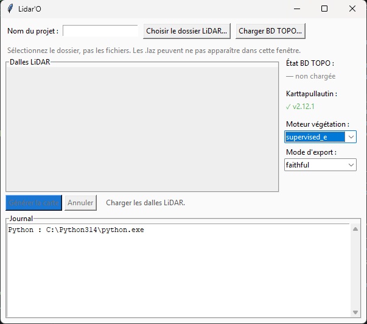
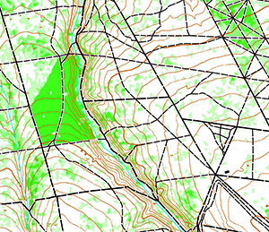

# Lidar'O

*[English version](README.md)*

**Lidar'O génère automatiquement une base de carte pour la course d'orientation** à partir des données LiDAR et des référentiels géographiques. Il produit un fichier `.omap` prêt à ouvrir dans OpenOrienteering Mapper, avec le relief, le réseau routier, l'hydrographie et une première proposition de végétation.

Le cartographe conserve la vérification terrain, la correction de la végétation et l'ajout des détails fins.

---

## Télécharger pour Windows (v0.4.0)

**[→ Télécharger la dernière version](https://github.com/guiguoz/lidar-o/releases/latest)** (~735 Mo)

Aucune installation de Python, Conda, GDAL ou PDAL requise.

**Installation :**

1. Télécharger et **extraire entièrement** le ZIP → dossier `LidarO-v0.4.0-Windows-x64/`
2. Double-clic `setup.bat` — initialisation unique (~2 min), **attendre sa réussite**
3. Double-clic `LidarO.bat` → GUI

> **Guide inclus :** ouvrir `docs/DEMARRER.html` dans le dossier extrait pour le parcours pas à pas.

> **Dossier de résultats :** choisir un dossier hors du dossier application (par exemple `Documents\mes-cartes\`), pour ne pas perdre les calculs lors d'une mise à jour. En installant la nouvelle version dans un nouveau dossier, les résultats existants restent en place.

> **Version expérimentale** — testée sous Windows 11 — vérification terrain nécessaire avant diffusion d'une carte officielle — mises à jour manuelles (télécharger dans un nouveau dossier, relancer `setup.bat`).

---


*Interface graphique — sélecteurs LiDAR, BD TOPO, moteur végétation et mode d'export*


*Résultat Lidar'O ouvert dans OpenOrienteering Mapper — terrain Grimbosq (Normandie)*

---

## Ce que Lidar'O produit

```
vectorisé et symbolisé :
  relief            — courbes de niveau depuis Karttapullautin
  chemins / routes  — BD TOPO
  bâtiments         — BD TOPO
  hydrographie      — BD TOPO
  terrain découvert et zones agricoles
  zones interdites
  végétation 406 / 408 / 410  — estimation automatique (voir modes ci-dessous)

assemblage et géoréférencement
→ fichier .omap ouvrable directement dans OpenOrienteering Mapper
```

## Ce que Lidar'O ne produit pas

- Falaises ni rochers (symboles 201/202 désactivés)
- Symboles ponctuels ni plantations en rangs
- Carte terminée : la végétation automatique est une base de travail à corriger au terrain

---

## Modes de végétation

| Mode | Principe | Statut |
|---|---|---|
| `kp` (par défaut) | Karttapullautin extrait une image de végétation depuis le LiDAR ; les couches 406/408/410 sont vectorisées à partir de cette image. | Stable |
| `supervised_e` | Calcul direct depuis la structure verticale du nuage de points — 4 niveaux (401/406/408/410). | Expérimental |

Les deux modes fonctionnent de manière autonome depuis les données LiDAR, sans référentiel cartographique extérieur à l'inférence.

**Quelle combinaison choisir ?**

- **`kp`** (défaut) : toujours disponible, sans modèle supplémentaire.
- **`supervised_e` + `faithful`** : utilise le modèle pré-entraîné inclus dans le paquet Windows. Export fidèle — polygones exportés tels quels, sans filtrage. La végétation produite est une estimation indicative à partir de la structure verticale du nuage de points — vérification terrain nécessaire.
- **`supervised_e` + `smoothed`** : même modèle, même classification — les frontières communes entre classes de végétation sont arrondies par un filtre gaussien (σ = 1,5 m). Aucun vote raster, aucun seuil de surface. Le modèle sous-jacent est identique à `faithful`.
- **`supervised_e` + `generalized`** : même estimation, avec simplification géométrique (MMU + lissage).

**Mode d'export** (`vegetation_export_mode`, `supervised_e` uniquement) :

| Valeur | Effet |
|---|---|
| `faithful` **(défaut)** | Export fidèle raster → vecteur — aucune perte, rendu brut |
| `smoothed` | Frontières communes arrondies (arc gaussien, σ = 1,5 m) — même modèle, contours adoucis |
| `generalized` | Simplification géométrique (MMU + lissage) — rendu cartographique propre |

---

## Données d'entrée

| Donnée | Source | Emplacement |
|---|---|---|
| Dalles LiDAR HD (`*.copc.laz`) | [IGN Géoplateforme](https://geoservices.ign.fr/lidarhd) | dossier au choix |
| BD TOPO (GPKG département, France) | [geoservices.ign.fr/bdtopo](https://geoservices.ign.fr/bdtopo) | fichier au choix |

---

## Premier projet

1. Lancer la GUI via `LidarO.bat`
2. **Nom du projet** — saisir un nom (ex. `ma_foret`)
3. **Choisir le dossier LiDAR…** — sélectionner le dossier contenant les dalles `.copc.laz`
4. **Charger BD TOPO…** — sélectionner le fichier `.gpkg` du département
5. **Générer**

Résultat : fichier `.omap` dans le dossier de résultats choisi — ouvrir dans OpenOrienteering Mapper.

Le projet est créé automatiquement à partir des noms de fichiers IGN. Aucune commande à saisir pour les données IGN France standard.

---

## Domaine de validité

| | |
|---|---|
| **Testé** | Forêt normande de feuillus (Normandie) — LiDAR HD IGN — COPC — Lambert-93 — acquisition hors feuillaison |
| **Non testé** | Forêts de montagne, landes, résineux denses, acquisitions en feuillaison |
| **Portable** | CRS déduit automatiquement ; convergence des méridiens calculée ; deux pays traités (France, Estonie) |
| **Attention** | La portabilité du code ne garantit pas la qualité des résultats végétation hors du domaine testé |

La végétation automatique est une **estimation** — elle doit être vérifiée et complétée par relevé terrain avant diffusion d'une carte officielle.

---

## Guide complet

→ **[docs/DEMARRER.html](docs/DEMARRER.html)** (inclus dans le paquet Windows) — installation, configuration, exemple complet, dépannage
→ **[docs/guide_utilisateur.md](docs/guide_utilisateur.md)** — même contenu en Markdown, accessible depuis le dépôt
→ **[Télécharger la BD TOPO](docs/guide_utilisateur.md#télécharger-et-préparer-la-bd-topo-france-uniquement)** — pas-à-pas IGN : format, département, extraction, rangement

Documentation technique :
- [docs/supervised_e.md](docs/supervised_e.md) — mode supervised_e : architecture, modèle, résultats
- [docs/portabilite.md](docs/portabilite.md) — utilisation hors France
- [docs/bilan_v0.md](docs/bilan_v0.md) — expérimentations et résultats historiques

---

## Développeurs — installation depuis les sources

> Cette section s'adresse aux développeurs souhaitant modifier le code ou utiliser Lidar'O hors du paquet Windows.

### Prérequis

- **Windows** : [Miniconda](https://docs.conda.io/en/latest/miniconda.html) pour les dépendances géospatiales
- **Linux / Docker** : image fournie (`Dockerfile`)
- **OpenOrienteering Mapper** : [openorienteering.org](https://www.openorienteering.org/) pour ouvrir le `.omap` produit

### Étapes rapides (Windows)

```bat
rem 1. Cloner le dépôt
git clone https://github.com/guiguoz/lidar-o.git
cd lidar-o

rem 2. Installer les dépendances (Miniconda Prompt)
conda install -c conda-forge python=3.11 geopandas shapely scipy numpy ^
    python-pdal pdal rasterio ezdxf requests pyyaml
```

Lancer :

```bat
python main.py gui
```

### CLI (avancé / données non-IGN)

```bash
python main.py init ma_foret --center 49.043 -0.421  # déclare le terrain
python main.py setup ma_foret                         # configuration interactive
python main.py run ma_foret --tiles-dir LIDAR/        # lance le pipeline
```

À utiliser pour les coordonnées non-IGN, les emprises personnalisées ou les workflows scriptés.

---

## Architecture

```
main.py                   CLI + GUI (python main.py run / gui)
config.yaml               paramètres terrains et pipeline

src/
  vegetation.py           CO Generalization Engine (mode kp/hag)
  supervised_e.py         détection végétation depuis LiDAR (mode supervised_e)
  smooth_veg.py           lissage des frontières — mode d'export smoothed
  omap_writer.py          génération fichiers .omap
  pipeline_mode.py        résolution du mode végétation
  qa.py                   métriques et snapshot

gui/
  app.py                  interface tkinter
  worker.py               thread pipeline

scripts/
  fetch.py                extraction BD TOPO
  process_hag.py          classification raster HAG
  mappings/               tables correspondance ISOM

assets/
  ISOM 2017-2_10000.omap  gabarit symboles
  georef_*.xml            géoréférencement par terrain

docs/                     guides et documentation technique
experiments/              expérimentations et entraînement supervised_e
```

---

## Licence et crédits

**GNU Affero General Public License v3.0** — voir [LICENSE](LICENSE).

Utilisation libre, modification libre. Tout dérivé ou service réseau doit être publié sous AGPL v3 avec le code source.

Dépendances tiers :
- Gabarit ISOM 2017-2 extrait d'[OpenOrienteering Mapper](https://www.openorienteering.org/) (GPL-3.0)
- Table CRT extraite de [Blaze / Trailblaze Software](https://github.com/Trailblaze-Software/Blaze) (GPL-3.0)
- [Karttapullautin](https://github.com/karttapullautin/karttapullautin) v2.12.1 — binaire inclus dans le paquet Windows (GPL-3.0 ; source : [releases/tag/v2.12.1](https://github.com/karttapullautin/karttapullautin/releases/tag/v2.12.1)) ; en installation depuis les sources, téléchargé automatiquement par `setup`
